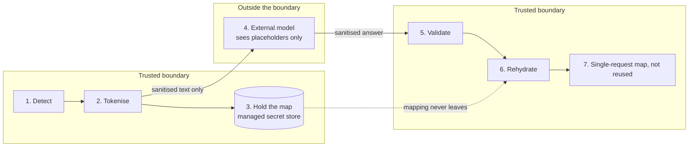

# Airlock: reversible, privacy-preserving inference

`🧪 PROTOTYPE · NOT YET EVALUATED` · Personal build

> A privacy layer for generative AI. It removes personal information before a prompt reaches an external model, then restores it in the answer for the person entitled to see it.

| | |
| --- | --- |
| **My role** | Designer and builder |
| **Timeframe** | Built over two days, 15 to 16 September 2026 |
| **Stack** | Python on Azure Functions, Microsoft Presidio for detection, a model hosted in Azure AI Foundry, Bicep |
| **Status** | Working prototype on synthetic data. No accuracy claims are made yet. |

Designed web version: [bp2professional.github.io/ai-engineering-portfolio/work/airlock/](https://bp2professional.github.io/ai-engineering-portfolio/work/airlock/)

## 1. Problem

People get real value from pasting work into a large language model, and that work is often full of personal information. Organisations usually answer with a blunt tool: block the AI tool, which pushes people to unmanaged ones, or trust the provider's terms, which still sends the data out. I wanted to explore a third option: **let the model do the reasoning without ever seeing the sensitive values**.

## 2. Approach

Sensitive values are swapped for **typed placeholders** before the prompt leaves, the mapping stays inside the trusted boundary, and the real values are put back only after the answer returns.

*Illustrative example of the intended behaviour, with synthetic data (not a recorded run):*

| Stage | Text |
| --- | --- |
| Original request | Summarise: Alex Morgan called from 0400 000 000 about a refund. Reply to alex.morgan@example.com. |
| What the model sees | Summarise: `[PERSON_001]` called from `[PHONE_NUMBER_002]` about a refund. Reply to `[EMAIL_ADDRESS_003]`. |
| What the model returns | `[PERSON_001]` wants a refund. Respond by email to `[EMAIL_ADDRESS_003]`. |
| What the person receives | Alex Morgan wants a refund. Respond by email to alex.morgan@example.com. |

Typed placeholders keep meaning: `[PERSON_001]` tells the model *there is a person here*, so the answer stays useful.

## 3. Architecture

The stages below describe the prototype's design intent.

## 4. Key decisions

| Decision | Why |
| --- | --- |
| Reversible, not one-way, redaction | One-way redaction protects the data but leaves the person with an answer they cannot use. |
| The mapping never crosses the boundary | Design intent: the model only sees placeholders. The mapping is the most sensitive object in the system, so it is held in a managed secret store rather than sent anywhere. |
| Keyless application code | The application reaches the model and the secret store through managed identity, so no keys or client secrets sit in the application code. |
| Refuse to restore on doubt | Design intent: if the answer contains a placeholder that was never issued, nothing is restored and the request fails. |
| Infrastructure as code as an adoption baseline first | The first template *describes* existing cloud resources without creating or changing any, and a documented preview (what-if) step comes before any template may make changes. |

## 5. Security and governance

Airlock applies a familiar data loss prevention idea (*sensitive data should not leave*) at a new boundary: the prompt. It complements platform controls such as sensitivity labels and DLP policies, and does not replace them.

Detection is probabilistic, so a layer like this **reduces exposure**. It does not guarantee that nothing sensitive leaves. Anyone deploying it needs measured detection coverage for the identifiers that matter in their context before real data goes near it.

> 🔒 **SECURITY REDACTION: IMPLEMENTATION DETAIL INTENTIONALLY WITHHELD**
> The detection configuration and the placeholder and validation logic are not published.

> 🔒 **HOST / INFRASTRUCTURE DETAIL: REDACTED**
> Cloud resource names, subscription and identity identifiers, endpoints and region are not published.

## 6. Evidence and result

What exists: a reversible core, an end-to-end flow against a model hosted in Azure AI Foundry, a serverless API in front of it, and an infrastructure baseline, built from an empty repository in two days and run with synthetic personal data only.

**What does not exist yet:** an evaluation set, or any accuracy, coverage or latency figures. That is why this case study is labelled *prototype* and *not yet evaluated*.

## 7. What I learned

- **Reversibility moves the risk rather than removing it.** Once values can be restored, the mapping becomes the crown jewel, and its lifecycle deserves more design attention than the model call.
- **Evaluation comes before claims.** The next step is a labelled test set of realistic Australian identifiers.
- **This is a platform conversation as much as an engineering one.** In an enterprise, the same outcome may be better served by sensitivity labels, DLP for AI and approved-model routing. A custom layer earns its place only where those cannot reach.
