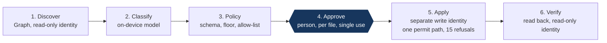

# Governed AI sensitivity labelling

`✅ DEMONSTRATED LIVE` · Personal build · Single-user developer tenant

> An on-device AI model proposes a Microsoft Purview sensitivity label for each file. Policy decides what is allowed, a person approves each write, and every label is proven by reading it back.

| | |
| --- | --- |
| **My role** | Designer and builder |
| **Timeframe** | 7 to 14 September 2026 |
| **Stack** | Python, Microsoft Graph, Microsoft Purview sensitivity labels, Foundry Local running Phi-4-mini on-device, Excel as the approval surface, GitHub Actions |
| **Scale** | 600+ automated tests; live runs against my own Microsoft 365 developer tenant |

Designed web version: [bp2professional.github.io/ai-engineering-portfolio/work/information-protection/](https://bp2professional.github.io/ai-engineering-portfolio/work/information-protection/)

## 1. Problem

Microsoft 365 Copilot and similar tools respect sensitivity labels, which makes labelling coverage one of the most important controls in any AI rollout. Most organisations have large volumes of unlabelled content, and nobody can label it all by hand.

AI can help classify content, but handing it the power to change labels turns a classifier's mistakes into policy, and usually sends document content to yet another service. I wanted to know whether AI could help close the coverage gap **without the content leaving the machine and without the model holding any authority**.

## 2. Approach

> **The model proposes. Policy decides. A person approves. Graph executes. Purview enforces. The audit trail proves it.**

- **Classification runs on-device.** Document content never goes to an external AI service.
- **The model can never write.** Its output is a proposal checked against a strict schema. Malformed output is rejected, not repaired. A deterministic sensitive-content floor stops the model going below it without review.
- **Every write needs a person.** Approvals are made in an Excel workbook. Only the approval columns are trusted; everything else is re-derived on import.
- **Proof is a read-back, not an API response.** A label counts as applied only when it is read back through a separate read-only identity.

## 3. Architecture

## 4. Security and governance

The write gate is a pure function with exactly one path that permits a write. Everything else is one of fifteen named refusals, and every attempt writes an evidence record. Examples: no approval (a classification is never an approval); approval already used or expired; file or label changed since approval; current label unknown, or two sources disagree; downgrade not separately approved.

Reading and writing use **two separate app identities** with the narrowest delegated permissions that do the job. Label removal cannot be expressed at all. Batches are frozen manifests identified by a digest, and a command-line limit caps how many files a run may touch.

> 🔒 **HOST / INFRASTRUCTURE DETAIL: REDACTED**
> Tenant, app registration, certificate and label identifiers, file names and locations, and tenant configuration are not published.

> 🔒 **SECURITY REDACTION: IMPLEMENTATION DETAIL INTENTIONALLY WITHHELD**
> How content egress is enforced and verified is not published. The published outcome is the measurement from the application's own egress counter: zero bytes of document content sent to an external AI service.

> 🔒 **EMPLOYER / THIRD-PARTY IP: NOT INCLUDED**
> This is a personal build on my own Microsoft 365 developer tenant. It contains no employer data, configuration or intellectual property.

## 5. Evidence and result

| Measure | Result |
| --- | --- |
| Label coverage of label-capable files | **56.59% → 99.22%** (73 to 128 of 129) |
| Applied labels verified by independent read-back | **55 of 55** |
| Document content sent to an external AI service (app's own egress counter) | **0 bytes** |
| Metered API cost of the 55 writes | **US$0.10** (US$0.10175) |
| Golden-set quality gate before any write | 4 of 5 exact, no under-classification; passed because the one miss was a pre-registered known failure (small sample) |

On 14 September 2026 the full approval journey ran live: discovery, on-device classification, an approval workbook, a governed batch write and a read-back of every label. A fresh reclassification afterwards agreed with the applied label on all 55 files.

The golden-set failure is kept as a known failure and was not prompt-tuned away: the model confidently labelled an ambiguous note that should have gone to human review.

**Not claimed:** tenant-wide SharePoint coverage (the live runs covered one user's OneDrive on a developer tenant). **Designed, not built:** a Copilot Studio front end and policy-driven automation.

## 6. What I learned

- **An accepted request is not an applied label.** The API accepts a label write and applies it later, and its status can lag. Only a read-back counts: a read may be repeated, a write may not.
- **Deterministic floors catch what models miss.** On a long document with sensitive material buried in it, the model labelled every chunk *Internal*. The rule-based floor caught the sensitive section.
- **Map the model's vocabulary to the tenant's, not the other way round.** Ambiguous mappings map to nothing, so they fail closed.
- **Platform behaviour is part of the design.** Label replication, permission errors that look like missing files, and preview-only API routes all changed the architecture.
- **Local models are ready for proposals, not verdicts.** Good enough to shortlist labels; not good enough to be trusted alone, and the design never asks them to be.
