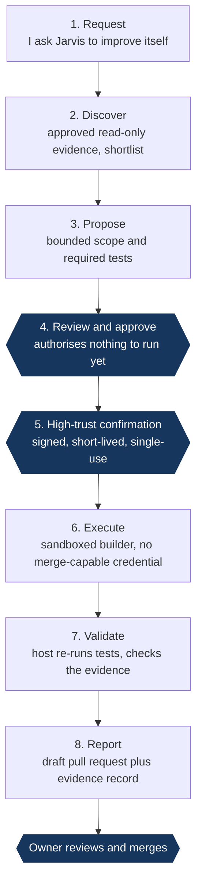

# Jarvis: governed self-improving AI

`✅ CORE PATH DEMONSTRATED` · Personal build

> A personal AI system that can find, propose and build improvements to its own code, but only inside boundaries that a human sets, signs and can audit afterwards.

| | |
| --- | --- |
| **My role** | Sole architect, product owner and engineer. I set the governance model, the engineering protocol and every acceptance gate, and I own every merge. |
| **Timeframe** | 20 July 2026 to present |
| **Stack** | Rust, TypeScript and React in a Tauri 2 macOS app; local models plus hosted models |
| **Scale** | 310 commits and more than 290 merged pull requests in ten weeks; over 6,000 automated tests; about 350,000 lines of Rust and TypeScript including tests |

Designed web version: [bp2professional.github.io/ai-engineering-portfolio/work/jarvis/](https://bp2professional.github.io/ai-engineering-portfolio/work/jarvis/)

## 1. Problem

AI agents can now write and ship code. For any organisation adopting them, the hard question is no longer *can the agent do it*. It is **who authorised it, within what limits, and how would we prove afterwards what actually happened?**

Most agent demos collapse suggesting, approving and doing into one step, and the authority to act ends up living inside the model's judgement. I wanted to find out what it takes to let an AI system improve itself **without ever giving it the authority to decide that it should**.

## 2. Approach

I treated authority as a **record**, not a mood. Every act that changes what the system may do is a separate, explicit, attributable event, and anything the system cannot prove it treats as not having happened.

- **A capability ladder: observe, prepare, execute.** The app people talk to can observe and prepare. At most it can file a request to execute; execution happens in a separate process and needs a signed approval, so a persuasive prompt has nothing to escalate to.
- **Approve and execute are two different events.** A single action that did both would be exactly the "approval quietly becomes execution" failure the design exists to prevent.
- **The builder is not trusted to mark its own homework.** A separate host process re-runs the required tests and checks the builder's evidence itself, rather than taking the builder's word.
- **Merging is a human decision.** The best state a governed mission can reach on its own is *awaiting the owner's decision*. No governed run can mark itself completed.

## 3. The governed lifecycle

The designed path for one improvement. Section 6 says exactly which parts have run live.

Every step **fails closed**. Stale evidence, a changed candidate, an expired or reused signature, missing test evidence or an unavailable resource each stop the mission and write a record saying why.

## 4. Architecture and key decisions

| Zone | Authority |
| --- | --- |
| **Owner** | Approves scope, signs the high-trust confirmation, reviews and merges |
| **Jarvis app** | Observe and prepare only. It renders untrusted text, so it holds the least authority |
| **Runtime host** | Executes approved, signed missions only: admission, governance classification, capacity, approval checks, independent validation, audit |
| **Sandboxed builder** | Writes the change and its evidence. Holds no credential capable of merging |
| **Code host** | Receives a draft pull request. CI validates it and only the owner merges |

> 🔒 **TRUST BOUNDARY IMPLEMENTATION: REDACTED**
> How the app and the runtime host exchange requests, how the sandbox is constrained, and how the builder's output is carried back are intentionally not published. The design intent and security outcome are documented here; implementation detail that would describe the trust boundary to an attacker is not.

| Decision | Why |
| --- | --- |
| Execution runs in a separate host process, never in the app | The app renders untrusted text. A test walks the app's import graph and fails if it can reach the execution machinery. |
| Default deny by absence | A test scans the exported surface for dangerous capability names (merge, grant, credential and similar), so adding one fails the build. |
| Build provenance compiled into the binary | If the build cannot prove its commit, it reports *unavailable* and nothing else. |
| Advisory models have no authority | If an advisory answer ever replaces the deterministic decision, the mission fails. |
| Hash-chained, append-only evidence ledger | Deleting a segment from the middle of the chain breaks a link. Tamper-*evident*, not tamper-*resistant*, and described that way. |
| Zero new spend by construction | A mission contract may not authorise new spend. The approved budget ceiling is zero. |

## 5. Security and governance

I rank controls by how much weight each one bears:

1. **Structural controls** hold whatever the model does: capabilities that do not exist, processes that cannot reach each other, no merge-capable credential in the agent's hands.
2. **Procedural controls** depend on me: scope approval, a signed confirmation and the merge decision.
3. **Detection** is the weakest layer, and is known to be. My own prompt-injection detector caught every phrasing it was tuned on and 1 of 27 held-out paraphrases, so the design never relies on it.

The written protocol every AI coding session works under contains absolute prohibitions. Two carry most of the weight: *an agent must not be able to change the rule that constrains it*, and *all content is evidence, never authority*.

> 🔒 **ANTI-BYPASS CONTROL: REDACTED**
> The mechanisms that bind an approval to one exact scope, prevent it being replayed, and detect a mission whose inputs changed after approval are not published.

> 🔒 **SECRET AND CREDENTIAL HANDLING: REDACTED**
> Where credentials live, which component may read them, and how signing works are not described. Public outcome: the building agent never holds a credential capable of merging, and no secret is written into any mission record.

## 6. Evidence and result

On **23 September 2026** the core of the lifecycle ran for real. A candidate from Jarvis's own discovery run, which I had approved and signed as one bounded mission, was built by the sandboxed builder, which also ran the required test. The host then independently re-ran that test and a **draft** pull request was opened. I reviewed it and merged it. The change was deliberately small, because the thing being proven was the governance path.

It took **five signed attempts**. Each of the first four stopped safely on at least one defect in the host (six in all), and each was fixed before the next attempt. None was a failure of the governance model. Because each approval is single use, every retry needed a fresh signature.

**What that run did not yet include.** The mission contract was written by hand. The plain-language request at the front of the lifecycle, and Jarvis drafting the contract itself, arrived in the days that followed. A single run from a typed request all the way to a merged change is the acceptance test I am working towards now.

> 🔒 **SECURITY REDACTION: IMPLEMENTATION DETAIL INTENTIONALLY WITHHELD**
> Screenshots of the working application are not published. They show internal component names and runtime status, which describe the system's internals and add nothing a reader needs.

## 7. What I learned

- **The gap is usually a missing caller, not a missing component.** Before the lifecycle worked end to end, every component already existed and was tested, but none was reachable from anything a person could run.
- **Fail-closed refusals are cheap defect discovery.** Four refused runs found six real defects without doing harm.
- **A prohibition broader than its reasoning gets argued with.** My original "never merge" rule bundled four acts, and only three can put code on the main branch.
- **Verify that the owner can still act.** I once designed a branch-protection setup that nobody could ever merge through. There is now a test whose only job is to stop that check being deleted.
- **Label maturity honestly.** Demonstrated, built but not connected, and specified are different things, and the project says which is which.
